# Project Title

Automated Jenkins Job Triggered by Access Log Size and S3 Backup

---

## Project Description

This project implements an automated log management system using Linux, Jenkins, AWS S3, AWS CLI, Shell Scripting, and Cron.

The system continuously monitors an Apache HTTPD access log file. When the log file exceeds a configured size threshold, Jenkins is automatically triggered via its REST API. The Jenkins pipeline then:

1. Checks whether the access log exists and is non-empty.
2. Uploads the log file to an Amazon S3 bucket.
3. Verifies that the uploaded object exists in S3.
4. Compares the local file size with the S3 object size.
5. Clears the original log file only after successful verification.
6. Reports success or failure in the Jenkins console.

The monitoring script records all activity in a dedicated log file and runs on a Cron schedule, so the whole pipeline operates without manual intervention.

For testing, the threshold can be temporarily set to a small value (e.g. 1 KB). In production it is set to 1 GB.

**Architecture**

```
                    ┌──────────────────────┐
                    │      Apache HTTPD    │
                    │ /var/log/httpd/      │
                    │ access_log           │
                    └──────────┬───────────┘
                               │ Monitor size
                               ▼
                    ┌──────────────────────┐
                    │   Monitoring Script  │
                    │ monitor_access_log.sh│
                    └──────────┬───────────┘
                          Size > 1 GB
                               ▼
                    ┌──────────────────────┐
                    │   Jenkins Pipeline   │
                    │ log-upload-to-s3     │
                    └──────────┬───────────┘
                        AWS CLI Upload
                               ▼
                    ┌──────────────────────┐
                    │      Amazon S3       │
                    │ jenkins-access-log-  │
                    │ prajwal-2026         │
                    └──────────┬───────────┘
                          Verify upload
                               ▼
                    ┌──────────────────────┐
                    │  Original Log File   │
                    │ Cleared only after   │
                    │ successful upload    │
                    └──────────────────────┘
```

---

## Prerequisites

**Operating System**
- Amazon Linux 2023
- Root or sudo access

**Software**
- Java
- Jenkins
- Apache HTTPD
- AWS CLI
- Git
- Cron / cronie
- curl
- ACL utilities (`setfacl` / `getfacl`)

**AWS Requirements**
- AWS account
- S3 bucket
- IAM role with required S3 permissions
- EC2 instance with the IAM role attached

**Jenkins Requirements**
- Jenkins installed and running
- Jenkins administrator access
- Jenkins Pipeline plugin
- Jenkins API token

---

## Technologies Used

| Technology | Purpose |
|---|---|
| Linux (Amazon Linux 2023) | Host environment |
| Apache HTTPD | Generates access logs |
| Shell Script | Monitors log size, triggers Jenkins |
| Jenkins | Automation and pipeline execution |
| Jenkins REST API | Automatically triggers the pipeline |
| AWS CLI | Uploads logs to S3 |
| Amazon S3 | Log backup storage |
| IAM Role | Secure AWS authentication (no static keys) |
| Cron | Periodic monitoring |
| Git / GitHub | Version control and project repository |

---

## Installation Steps

Quick-reference install commands (see **Implementation Steps** below for the full walkthrough with verification and screenshots).

```bash
# Java
sudo dnf install java-21-amazon-corretto -y

# Jenkins (repo + install — commands per your Jenkins version/OS docs)
sudo systemctl enable jenkins
sudo systemctl start jenkins

# Apache HTTPD
sudo dnf install httpd -y
sudo systemctl enable httpd
sudo systemctl start httpd

# AWS CLI
# (install per AWS documentation for Amazon Linux 2023)

# ACL utilities
sudo dnf install acl -y

# Cron
sudo systemctl enable crond
sudo systemctl start crond
```

---

## Project Structure

```
jenkins-log-upload-s3/
├── README.md
├── scripts/
│   └── monitor_access_log.sh
├── jenkins/
│   └── Jenkinsfile
├── config/
│   └── cron-example.txt
├── screenshots/
│   ├── 01-ec2-server.png
│   ├── 02-java-version.png
│   ├── 03-jenkins-status.png
│   ├── 04-apache-status.png
│   ├── 05-access-log.png
│   ├── 06-aws-identity.png
│   ├── 07-s3-bucket.png
│   ├── 08-jenkins-pipeline.png
│   ├── 09-s3-upload.png
│   ├── 10-s3-verification.png
│   ├── 11-log-cleared.png
│   ├── 12-monitor-script.png
│   ├── 13-jenkins-trigger.png
│   └── 14-cron.png
└── docs/
    └── implementation.md
```

---

## Implementation Steps

Each step below is followed immediately by its deliverable(s), as required.

### Step 1: Prepare the EC2 Server

Create or use an Amazon Linux 2023 EC2 instance and verify the OS:

```bash
cat /etc/os-release
```

Expected: `Amazon Linux 2023`

**Deliverable**
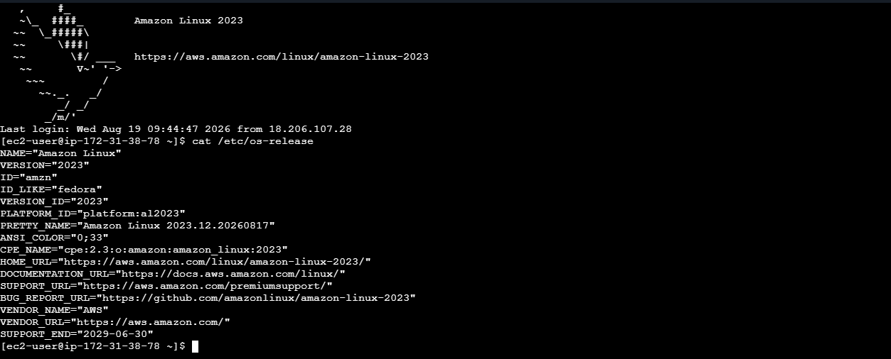

---

### Step 2: Install Java

```bash
java -version
# if not installed:
sudo dnf install java-21-amazon-corretto -y
java -version
```

**Deliverable**
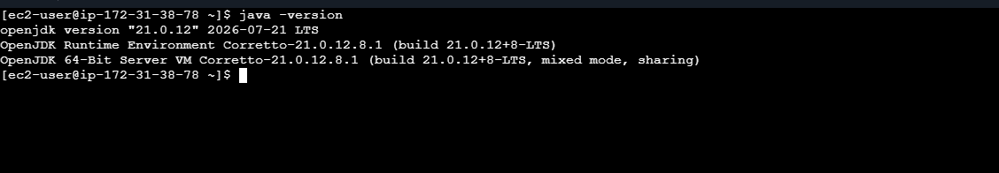

---

### Step 3: Install Jenkins

```bash
sudo systemctl status jenkins
```

Expected: `Active: active (running)`

```bash
sudo systemctl enable jenkins
```

**Deliverable**
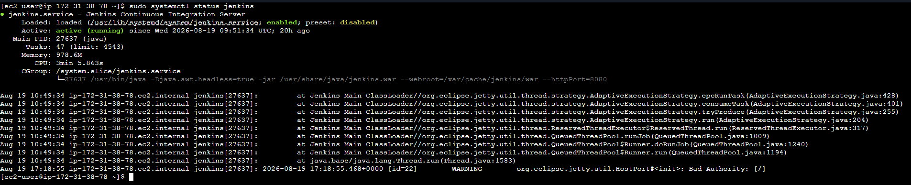

---

### Step 4: Install Apache HTTPD

```bash
sudo dnf install httpd -y
sudo systemctl start httpd
sudo systemctl enable httpd
sudo systemctl status httpd
sudo ls -lh /var/log/httpd/
```

Expected: `access_log`, `error_log`

**Deliverable**
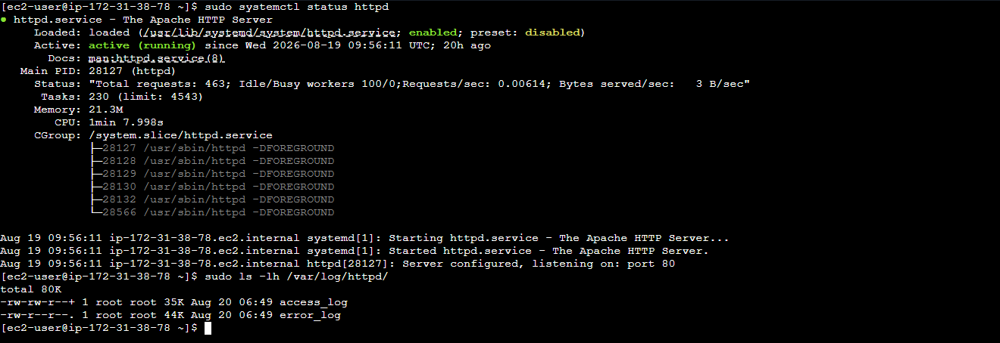

---

### Step 5: Verify Access Log

```bash
sudo ls -lh /var/log/httpd/access_log
sudo tail /var/log/httpd/access_log
sudo wc -c /var/log/httpd/access_log
```

**Deliverable**
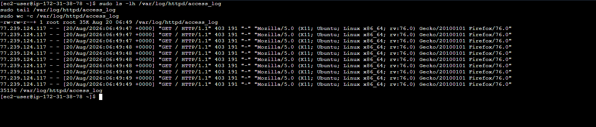

---

### Step 6: Configure Jenkins Access to the Log

The Apache log is owned by root, so Jenkins can't access it by default. Grant access via ACL:

```bash
sudo setfacl -m u:jenkins:rw /var/log/httpd/access_log
sudo getfacl /var/log/httpd/access_log
sudo -u jenkins head /var/log/httpd/access_log

sudo -u jenkins bash -c \
'test -w /var/log/httpd/access_log && echo "Jenkins CAN write to access_log" || echo "Jenkins CANNOT write to access_log"'
```

Expected: `Jenkins CAN write to access_log`

**Deliverable**
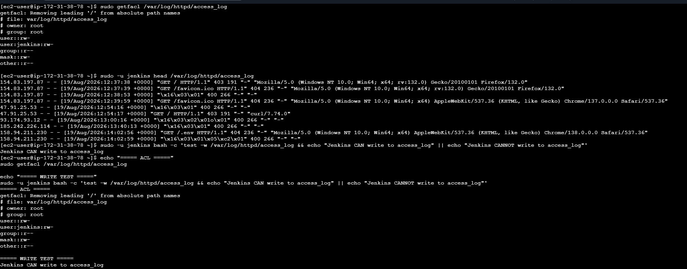

---

### Step 7: Configure AWS IAM Role

Attach an IAM role to the EC2 instance that grants access to the S3 bucket, then verify:

```bash
sudo -u jenkins aws sts get-caller-identity
```

Expected: an ARN such as `arn:aws:sts::ACCOUNT_ID:assumed-role/jenkins-log-s3-role/...`

**Deliverable**
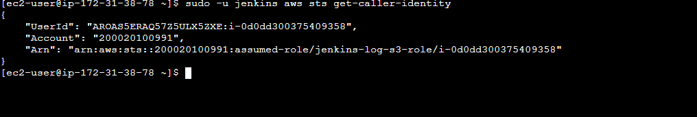

---

### Step 8: Verify S3 Access

```bash
sudo -u jenkins aws s3 ls s3://jenkins-access-log-prajwal-2026

echo "Jenkins S3 Pipeline test" > /tmp/jenkins-s3-test.txt

sudo -u jenkins aws s3 cp \
  /tmp/jenkins-s3-test.txt \
  s3://jenkins-access-log-prajwal-2026/jenkins-s3-test.txt

sudo -u jenkins aws s3api head-object \
  --bucket jenkins-access-log-prajwal-2026 \
  --key jenkins-s3-test.txt
```

**Deliverable**
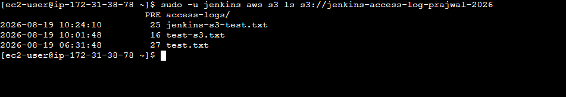


---

### Step 9: Create Jenkins Pipeline

Create a Jenkins Pipeline job named `log-upload-to-s3` using the `Jenkinsfile` at `jenkins/Jenkinsfile` (full contents in that file — see the **Project Structure** section).

**Deliverable**
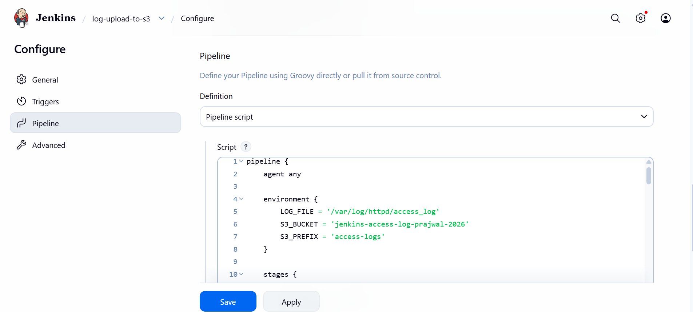


---

### Step 10: Test Jenkins Pipeline

Click **Build Now** in Jenkins. The pipeline runs:

```
Check Log → Upload to S3 → Verify Upload → Clear Log
```

Expected final result: `Finished: SUCCESS`

**Deliverable**
📸 


---

### Step 11: Verify S3 Upload

```bash
sudo -u jenkins aws s3 ls s3://jenkins-access-log-prajwal-2026/access-logs/

sudo -u jenkins aws s3api head-object \
  --bucket jenkins-access-log-prajwal-2026 \
  --key access-logs/<OBJECT_NAME>
```

The S3 `ContentLength` should match the original log size.

**Deliverable**
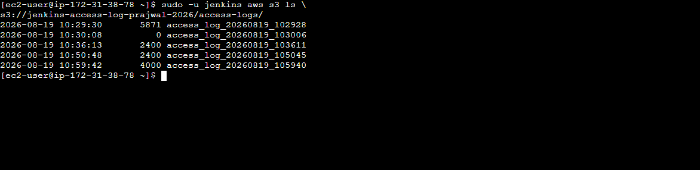
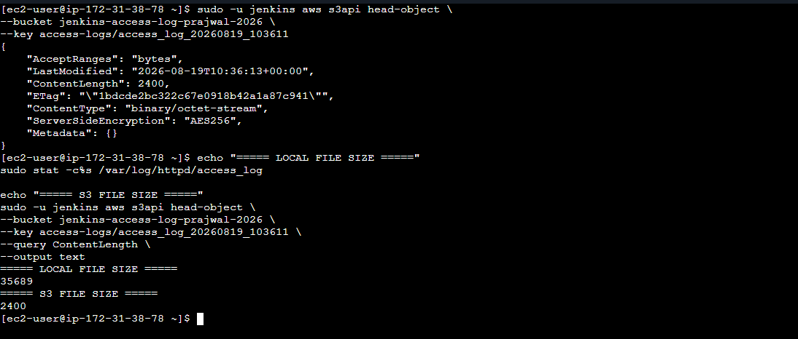


---

### Step 12: Verify Log Was Cleared

```bash
sudo wc -c /var/log/httpd/access_log
```

Expected: `0 /var/log/httpd/access_log`

```bash
sudo ls -lh /var/log/httpd/access_log
```

Expected size: `0`

**Deliverable**
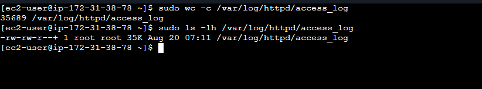


---

### Step 13: Create Monitoring Script

```bash
sudo vi /usr/local/bin/monitor_access_log.sh
```

Use the script at `scripts/monitor_access_log.sh` (full contents in that file). Make it executable:

```bash
sudo chmod 755 /usr/local/bin/monitor_access_log.sh
```

**Deliverable**
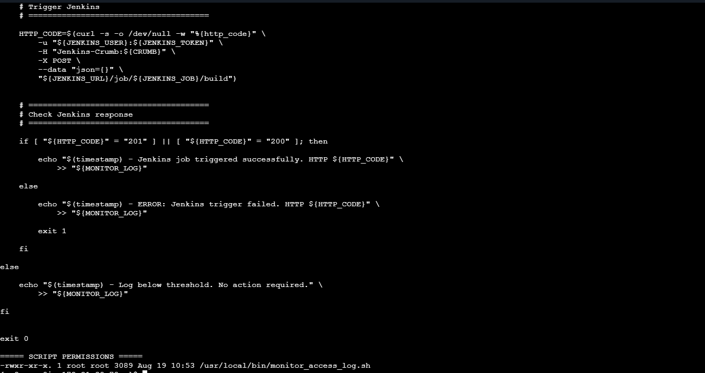

---

### Step 14: Test Jenkins REST API

```bash
sudo bash -c '
source /root/.jenkins_monitor_credentials
curl -s -o /dev/null -w "%{http_code}\n" \
  -u "${JENKINS_USER}:${JENKINS_TOKEN}" \
  "http://localhost:8080/api/json"
'
```

Expected: `200`

```bash
sudo /usr/local/bin/monitor_access_log.sh
sudo tail -20 /var/log/access_log_monitor.log
```

Expected:

```
WARNING: Log exceeded threshold
Triggering Jenkins job
Jenkins job triggered successfully. HTTP 201
```

**Deliverable**
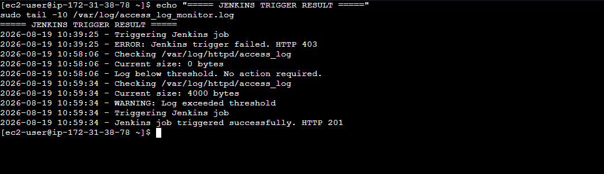

---

### Step 15: Test Automatic Trigger

Temporarily lower the threshold for testing:

```bash
THRESHOLD=1000   # was: $((1024 * 1024 * 1024))
```

Generate traffic and re-check:

```bash
for i in {1..50}; do curl -s http://localhost/ > /dev/null; done
sudo wc -c /var/log/httpd/access_log
sudo /usr/local/bin/monitor_access_log.sh
sudo tail -10 /var/log/access_log_monitor.log
```

Expected:

```
WARNING: Log exceeded threshold
Triggering Jenkins job
Jenkins job triggered successfully. HTTP 201
```

**Restore the production threshold afterward:**

```bash
THRESHOLD=$((1024 * 1024 * 1024))
```

**Deliverable**


---

### Step 16: Configure Cron

```bash
sudo crontab -e
```

Add (also saved at `config/cron-example.txt`):

```
*/5 * * * * /usr/local/bin/monitor_access_log.sh
```

```bash
sudo crontab -l
```

**Deliverable**
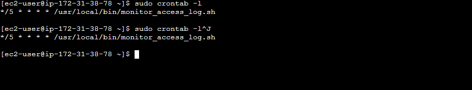

---

### Step 17: Monitor Automation

```bash
sudo tail -f /var/log/access_log_monitor.log
```

Normal state:

```
2026-08-20 11:00:00 - Checking /var/log/httpd/access_log
2026-08-20 11:00:00 - Current size: 500 bytes
2026-08-20 11:00:00 - Log below threshold. No action required.
```

Threshold exceeded:

```
2026-08-20 11:05:00 - Checking /var/log/httpd/access_log
2026-08-20 11:05:00 - Current size: 1073742000 bytes
2026-08-20 11:05:00 - WARNING: Log exceeded threshold
2026-08-20 11:05:00 - Triggering Jenkins job
2026-08-20 11:05:00 - Jenkins job triggered successfully. HTTP 201
```

**Deliverable**


---

### Step 18: Final End-to-End Test

```
Apache generates access log → access_log grows → Cron executes monitoring script
→ Script checks file size → Size > 1 GB → Jenkins REST API triggered
→ Jenkins Pipeline starts → Check log → Upload to S3 → Verify S3 object
→ Compare file sizes → Clear original log → Log size = 0 bytes → Jenkins SUCCESS
```

**Deliverable**

All screenshots above, taken together, are the end-to-end proof of the working pipeline.

---

## Screenshots

| # | File | Evidence |
|---|---|---|
| 1 | `screenshots/01-ec2-server.png` | EC2 / Amazon Linux OS confirmation |
| 2 | `screenshots/02-java-version.png` | Java installed |
| 3 | `screenshots/03-jenkins-status.png` | Jenkins running |
| 4 | `screenshots/04-apache-status.png` | Apache running + access log present |
| 5 | `screenshots/05-access-log.png` | Access log contents/size |
| 6 | `screenshots/06-aws-identity.png` | AWS IAM identity (Jenkins role) |
| 7 | `screenshots/07-s3-bucket.png` | S3 bucket access confirmed |
| 8 | `screenshots/08-jenkins-pipeline.png` | Jenkins Pipeline job + successful build |
| 9 | `screenshots/09-s3-upload.png` | Log uploaded to S3 |
| 10 | `screenshots/10-s3-verification.png` | Local vs. S3 size match |
| 11 | `screenshots/11-log-cleared.png` | Original log cleared (0 bytes) |
| 12 | `screenshots/12-monitor-script.png` | Monitoring script in place |
| 13 | `screenshots/13-jenkins-trigger.png` | Automatic Jenkins trigger (HTTP 201) |
| 14 | `screenshots/14-cron.png` | Cron job configured |

---

## Deliverables

1. **Monitoring Script** — `scripts/monitor_access_log.sh`
2. **Jenkins Pipeline** — `jenkins/Jenkinsfile`
3. **Cron Configuration** — `config/cron-example.txt`
4. **S3 Upload Proof** — Jenkins console output showing `Upload completed successfully`
5. **S3 Verification Proof** — Jenkins output showing:
   ```
   Local size: 2400 bytes
   S3 size:    2400 bytes

   S3 verification successful
   ```
6. **Cleared Log Proof** — `0 /var/log/httpd/access_log`
7. **Jenkins Trigger Proof** — monitoring log showing `Jenkins job triggered successfully. HTTP 201`
8. **Cron Proof** — `*/5 * * * * /usr/local/bin/monitor_access_log.sh`
9. **Screenshots** — all 14 files listed in the **Screenshots** section above
10. **GitHub Repository** — public repo containing all of the above

---

## Results

The completed project demonstrates a fully automated log management workflow, capable of:

- Monitoring Apache access logs continuously
- Detecting when the configured size threshold is exceeded
- Triggering Jenkins automatically through the REST API
- Uploading logs to Amazon S3
- Verifying the S3 upload
- Comparing local and S3 object sizes
- Clearing the original log only after successful verification
- Recording monitoring activity
- Running automatically via Cron, with no manual intervention

During testing:

- Jenkins was triggered successfully with `HTTP 201`
- The Jenkins pipeline completed with `Finished: SUCCESS`
- The S3 object size matched the original log size, and the log was cleared to `0 bytes`

---

## Security Considerations

- Uses an **IAM role attached to the EC2 instance** rather than static AWS access keys.
- Jenkins API credentials are stored **outside the Git repository**, at `/root/.jenkins_monitor_credentials` (`chmod 600`).
- **Never commit** `JENKINS_TOKEN`, `AWS_ACCESS_KEY_ID`, or `AWS_SECRET_ACCESS_KEY` — and check screenshots for accidental exposure before uploading.

---

## Conclusion

This project provides an automated and secure solution for managing large Apache access logs. Instead of manually monitoring and backing up logs, the system automatically detects when the log reaches the configured threshold, triggers Jenkins, uploads the log to Amazon S3, verifies the uploaded object, and clears the original log only after successful verification.

**Stack:** Linux · Apache · Shell Scripting · Cron · Jenkins · Jenkins REST API · AWS CLI · IAM · Amazon S3 · GitHub

This demonstrates practical DevOps, AWS, CI/CD automation, Linux administration, scripting, and cloud storage skills.

---

